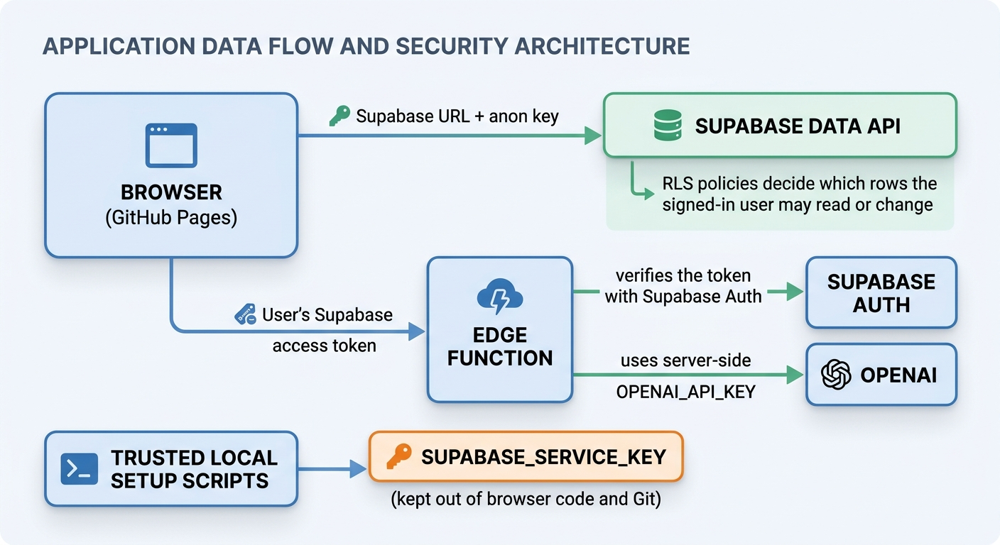

# Reflection

## 1. Security Architecture ⭐⭐⭐⭐⭐

### Security flow

```text
Browser (GitHub Pages)
  ├─ Supabase URL + anon key ──> Supabase Data API
  │                               └─ RLS policies decide which rows the
  │                                  signed-in user may read or change
  └─ User's Supabase access token ──> Edge Function
                                      ├─ verifies the token with Supabase Auth
                                      └─ uses server-side OPENAI_API_KEY ──> OpenAI

Trusted local setup scripts ──> SUPABASE_SERVICE_KEY
                                 (kept out of browser code and Git)
```



The anon key is intended to identify the Supabase project in client-side
applications, so it is expected to be visible in `config.public.json` and in
browser network requests. It is not a password and does not, by itself, grant
unrestricted access. The database's grants and Row Level Security (RLS)
policies must restrict what requests made with it can do. In this project,
`page_views` has public policies, while `sentence_embeddings` has a
read policy for the `authenticated` role.

The service-role key is different: it is privileged and bypasses RLS. Someone
who obtains it could read, modify, or delete protected database data beyond
what normal user policies allow. It belongs only in trusted server-side
environments or local administrative scripts; it must never be placed in
browser code, committed, or shared.

The OpenAI API key is also secret. The browser calls Supabase Edge Functions
instead of calling OpenAI directly. The functions read `OPENAI_API_KEY` from
server-side secrets, so the key is not sent to the browser. The function also
checks the caller's bearer token before using the key.

RLS is the database-enforced authorization layer. It applies policies to rows
even when a client connects directly to the Data API, rather than relying only
on the app to hide or filter data. RLS is only as protective as its policies:
any rows explicitly allowed to the `anon` role are public to anyone with the
project URL and anon key.

## 2. Edge Functions & the "Secure Middle" ⭐⭐⭐⭐⭐

Calling OpenAI directly from a browser would expose the OpenAI API key in
downloadable JavaScript or network requests. Anyone could copy it and use the
account's quota and billing. A browser is a public environment, so secrets
cannot be protected there.

Instead, the flow is:

1. The signed-in browser invokes an Edge Function with the question and its
   Supabase access token.
2. The function checks the bearer token with Supabase Auth. This verifies that
   the request is associated with a valid signed-in user; it is not the OpenAI
   key and does not replace database RLS.
3. If verification succeeds, the function reads the private OpenAI key from its
   server-side environment and requests an embedding or generated answer.
4. The function returns only the result needed by the app.

The same pattern is useful whenever a public client needs a private capability:
for example, a backend can validate a user, enforce input and usage limits, and
call a payment, email, maps, or AI provider without revealing that provider's
secret key. Authentication identifies the caller; the server must still
authorize the requested action and manage abuse and costs.

## 3. From SQL to Semantics ⭐⭐⭐⭐

Keyword search in this app uses SQL `ILIKE` to find text containing the
entered words or phrase (case-insensitively). It is fast and predictable for
known names, exact quotations, or distinctive words. It can miss relevant
passages when they use different wording.

Semantic search turns text into embeddings—vectors of numbers representing
features learned from language data. The app embeds the question and compares
it with stored sentence embeddings using cosine distance in pgvector. Vectors
with similar directions are treated as semantically related. This can retrieve
passages with different words but similar ideas; it does not mean the database
understands the text like a person, and retrieval can still be wrong.

For example, keyword search for **"peace during hard times"** may miss a
sentence that says **"the Savior can calm our hearts in seasons of trial"**
because the exact words differ. Semantic search may retrieve it because the
phrasing is related in meaning. Conversely, if I need a passage containing a
specific phrase such as **"faith as small as a mustard seed,"** `ILIKE` is
better for finding that exact wording; semantic search may return generally
related passages that do not contain the quote.

The two approaches complement each other: keyword search is useful for exact
terms, while vector search is useful for paraphrases and conceptual queries.

## 4. RAG vs Fine-Tuning ⭐⭐⭐⭐

Fine-tuning continues training a pretrained model on a curated set of examples
so it learns to respond in a desired way, such as following a format, adopting
a style, or performing a specialized task. It changes the model's learned
parameters; it is not the same as giving the model a document to consult for
one request.

RAG retrieves relevant source material at query time and supplies it as context
to the model. In this project, pgvector finds relevant conference-talk
sentences, the app gathers context from the best-matching talks, and GPT-4o
generates an answer with talk citations.

RAG is a good choice here because the talks are a large collection of factual
source documents. The collection can be updated by importing and embedding new
talks, without retraining a model. The retrieved context can be cited and
checked against the original talks. The trade-offs are that retrieval adds
system components and latency, and missed or poor search results can lead to
incomplete or incorrect answers. The model may also misinterpret the context,
so citations and evaluation still matter.

Fine-tuning could be a better choice when the main goal is consistent behavior,
tone, or output structure across many requests, especially when there are many
high-quality examples of the desired behavior. It is usually not the best way
to make a model reliably recall and cite a changing collection of detailed
talks: updates require more training, and the model's learned parameters do not
provide the same direct source references as retrieval.

## 5. AI-Assisted Development ⭐⭐⭐

My AI coding assistant helped explain concepts such as RLS, embeddings,
chunking, and RAG; it also helped build the `embed-question` and
`generate-answer` Edge Functions and add the conference-theme feature. It was
useful for tracing the app's flow and turning a feature idea into code and
tests.

I also had to guide it and check its assumptions. During the vector-search
timeout investigation, the assistant initially focused on adding an index to
the assignment schema script. I pointed out that the assignment files were
likely correct and asked it to inspect the Edge Functions and then the
documentation. Checking the actual database index state and the RPC call path
showed that the search was timing out before the answer-generation function
ran. That experience showed me that an AI suggestion should be verified
against logs, source code, and the live system rather than accepted because it
sounds plausible.

I learned to give the assistant concrete evidence, ask it to trace the whole
request path, and verify changes with tests or direct checks. AI can accelerate
implementation and explain unfamiliar material, but I remain responsible for
reviewing its reasoning, security implications, and results.